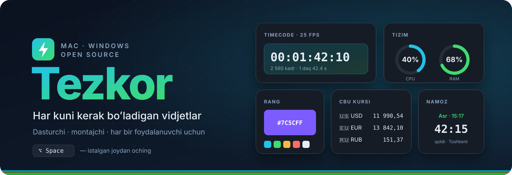

<div align="center">



<br/>

[](https://github.com/Sheyxzad999/tezkor/releases/latest)
[](https://github.com/Sheyxzad999/tezkor/actions)


[](LICENSE)

**Bitta yengil dastur — yettita foydali vidjet.**
<br/>Menyu panelida (Mac) yoki trayda (Windows) yashaydi, <kbd>⌥ Space</kbd> / <kbd>Alt+Space</kbd> bilan bir zumda ochiladi.
<br/>Istalgan vidjetni ish stoliga alohida suzuvchi oyna qilib chiqarish mumkin.

### [⬇️ Yuklab olish](https://github.com/Sheyxzad999/tezkor/releases/latest)

</div>

---

## 🧩 Vidjetlar

| | Vidjet | Kim uchun | Nima qiladi |
|---|---|---|---|
| 🎬 | **Timecode kalkulyator** | Montajchi | `HH:MM:SS:FF` qoʻshish/ayirish, kadr ↔ timecode, FPS oʻgirish. 23.976 / 24 / 25 / **29.97 DF** / 30 / 50 / **59.94 DF** / 60 |
| 🎨 | **Rang pipetkasi** | Montajchi, dizayner, dasturchi | Ekranning istalgan joyidan rang olish (<kbd>⌥⇧C</kbd>), HEX / RGB / HSL / **DaVinci float** / SwiftUI / Flutter, WCAG kontrast, tarix |
| 📊 | **Tizim monitori** | Dasturchi, montajchi | CPU (har bir yadro), RAM, tarmoq tezligi, disklar — render va build paytida juda kerak |
| 💱 | **Valyuta kursi** | Hamma | **OʻzR Markaziy banki** rasmiy kursi, oʻzgarish ▲▼, konvertor, summani soʻz bilan yozish |
| 🕌 | **Namoz vaqtlari** | Hamma | 15 ta shahar, keyingi namozgacha qolgan vaqt, vaqti kirganda **bildirishnoma** |
| 📋 | **Clipboard tarixi** | Hamma | Oxirgi 100 ta nusxa, qidiruv, qadab qoʻyish, turini aniqlash (URL, JSON, rang, telefon…) |
| 🛠 | **Dev asboblari** | Dasturchi | JSON format/minify, Base64, URL encode, **JWT decode**, UUID, Unix vaqt, SHA-256 |

**Tillar:** Oʻzbekcha (lotin va kirill) · Русский · English

## ⬇️ Oʻrnatish

[**Releases**](https://github.com/Sheyxzad999/tezkor/releases/latest) sahifasidan yuklab oling:

| Tizim | Fayl |
|---|---|
| 🍎 macOS (Apple Silicon va Intel) | `Tezkor_x.y.z_universal.dmg` |
| 🪟 Windows 10 / 11 | `Tezkor_x.y.z_x64-setup.exe` |

<details>
<summary><b>🍎 macOS: "Apple tekshira olmadi" degan oyna chiqsa</b></summary>

Dastur bepul va ochiq kodli, shuning uchun pullik Apple sertifikati bilan imzolanmagan.

1. Oynada **Готово / Done** ni bosing (Korzinaga tashlamang).
2. **Tizim sozlamalari → Maxfiylik va xavfsizlik** ni oching.
3. Pastda *"Tezkor bloklandi"* yozuvi yonidagi **Baribir ochish** ni bosing.

**Rang pipetkasi** birinchi marta ishlatilganda macOS **Ekranni yozib olish** ruxsatini soʻraydi — bu kursor ostidagi pikselni oʻqish uchun kerak. Dastur hech narsani yozib olmaydi va hech qayerga yubormaydi.
</details>

<details>
<summary><b>🪟 Windows: "Windows protected your PC" chiqsa</b></summary>

**More info → Run anyway** ni bosing. Sabab — dastur pullik sertifikat bilan imzolanmagan.
</details>

## ⌨️ Tezkor tugmalar

| Tugma | Amal |
|---|---|
| <kbd>⌥ Space</kbd> / <kbd>Alt + Space</kbd> | Tezkor'ni ochish / yashirish |
| <kbd>⌥ ⇧ C</kbd> / <kbd>Alt + Shift + C</kbd> | Kursor ostidagi rangni olish va nusxalash |

## 🔒 Maxfiylik

- Clipboard tarixi, ranglar va sozlamalar **faqat sizning kompyuteringizda** saqlanadi.
- Internetga faqat ikki joyga murojaat qilinadi: valyuta kursi (`cbu.uz`) va namoz vaqtlari (`islomapi.uz`, zaxira — `api.aladhan.com`).
- Hech qanday analitika yoki kuzatuv yoʻq.

## 🛠 Texnologiyalar

[Tauri 2](https://tauri.app) (Rust) + React + TypeScript. Electron'dan farqli oʻlaroq, dastur hajmi ~10 MB va juda kam xotira ishlatadi.

```
src/
  lib/          ← hisob-kitoblar (timecode, rang, valyuta, namoz…) + testlar
  widgets/      ← har bir vidjet
  App.tsx       ← panel, navigatsiya, suzuvchi oynalar
src-tauri/
  src/lib.rs    ← tray, global tugmalar, oynalar
  src/stats.rs  ← tizim monitori (sysinfo)
  src/color.rs  ← ekrandan rang olish (xcap)
```

### Ishga tushirish (dasturchilar uchun)

Kerak: [Node.js 22+](https://nodejs.org), [Rust](https://rustup.rs)

```bash
git clone https://github.com/Sheyxzad999/tezkor.git
cd tezkor
npm install
npm test             # mantiqiy testlar
npm run tauri dev    # dasturni ishga tushirish
npm run tauri build  # .dmg / .exe yigʻish
```

## 🗺 Reja

- [ ] Ob-havo vidjeti
- [ ] Pomodoro taymer va tezkor qaydlar
- [ ] Vidjetlarni ish stoliga mahkamlash (desktop layer)
- [ ] Avtomatik yangilanish
- [ ] Linux

Gʻoyangiz bormi? [Issue oching](https://github.com/Sheyxzad999/tezkor/issues) 🙌

## 🔗 Aloqador loyihalar

- [**uzkit**](https://github.com/Sheyxzad999/uzkit) — lotin ↔ kirill, soʻm formati, sonni soʻz bilan yozish (Tezkor ichida ishlatilgan)
- [**uz-payments**](https://github.com/Sheyxzad999/uz-payments) — Payme va Click integratsiyasi

## 📄 Litsenziya

[MIT](LICENSE) © [Shaxzod](https://sheyxzad.uz)

<div align="center"><sub>🇺🇿 Oʻzbekistonda ❤️ bilan yaratildi</sub></div>
